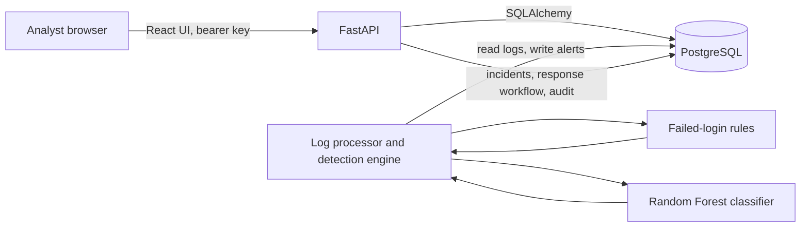
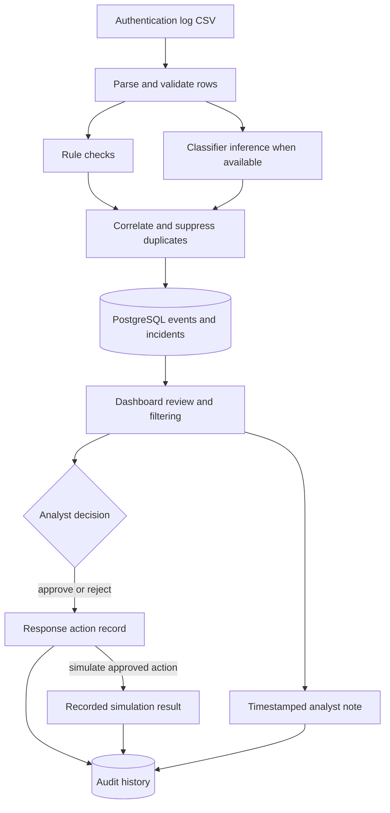
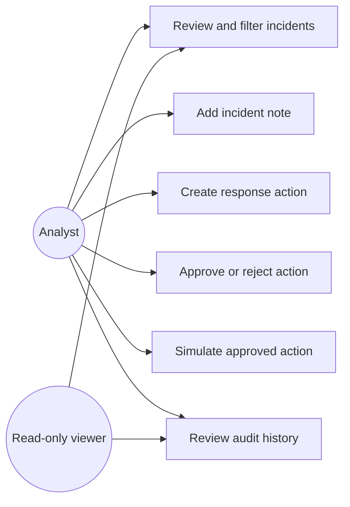
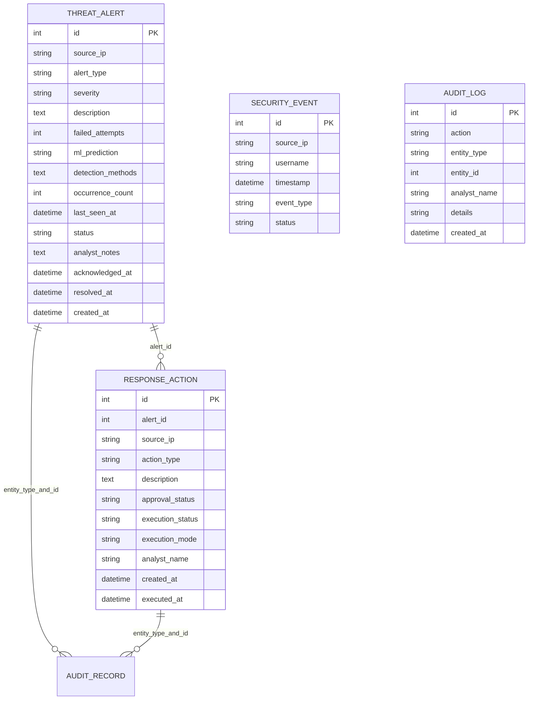

# CyberGuard AI: architecture, data flow, use cases, and API

## System architecture

The dashboard sends API requests to FastAPI. FastAPI and the detection engine persist application records in PostgreSQL. The detection engine combines the failed-login rule with the classifier when the model can load. Response-action simulation records a simulated result and does not change host or network configuration.

## Data flow

## Use cases

The API enforces the viewer's read-only role. The analyst role can perform the write workflows. Configure different long random keys for the two roles before enabling remote access. Without keys, the API only serves loopback clients.

## Database ER diagram

`SecurityEvent` records are stored separately from alerts. `ThreatAlert` stores appended notes in `analyst_notes`. The current ORM schema does not declare foreign-key constraints: `ResponseAction.alert_id` and `AuditLog.entity_type`/`entity_id` are application-level links. See `src/models.py` for the authoritative schema.

## API overview

FastAPI's interactive OpenAPI page is available at `/docs` while the local server is running. Current routes include:

| Route | Purpose | Access |
| --- | --- | --- |
| `GET /` | API welcome and documentation links | Public |
| `GET /health` | Service health | Public |
| `GET /auth/status` | Whether keys are configured | Public |
| `GET /auth/me` | Current role and configured analyst display name | Authenticated |
| `GET /detect` | Detection engine status | Analyst or viewer |
| `POST /detect` | Run detection | Analyst |
| `GET /history` and `GET /alerts/{alert_id}` | Incident review | Analyst or viewer |
| `PATCH /alerts/{id}/status` | Change incident status | Analyst |
| `PATCH /alerts/{id}/notes` | Append analyst note | Analyst |
| `GET /alerts/{alert_id}/response-actions` and `GET /response-actions` | Review response actions | Analyst or viewer |
| `POST /alerts/{alert_id}/response-actions` | Create a response action | Analyst |
| `PATCH /response-actions/{action_id}/decision` | Approve or reject | Analyst |
| `POST /response-actions/{action_id}/simulate` | Simulate an approved action | Analyst |
| `GET /audit-logs` | Review audit history | Analyst or viewer |

Exact parameters and response schemas are published by `/openapi.json` and `/docs`. Invalid payload fields are rejected. The API binds to loopback in the documented development command; configure CORS and secrets deliberately before deployment.

## Verification record

Verified on 2026-11-13:

- Python test suite: 33 passed, including brute-force, multi-account failed-login, benign mixed-login, threshold, and time-window detection scenarios, plus temporal benchmark-adapter checks.
- Live HTTP API smoke suite: all checks passed, including every documented route, `/docs` and `/redoc`, invalid payloads and limits, unauthenticated and invalid-key rejection, viewer denial on every write route, allowed and rejected CORS origins, response workflows, audit history, and persistence in disposable in-memory SQLite.
- Python source compilation: passed.
- Frontend lint: passed.
- Frontend production build: passed.
- Frontend authentication bootstrap remains on the sign-in screen if the authentication-status request fails, rather than assuming authentication is disabled.
- PostgreSQL connection: passed, server reports PostgreSQL 18.6. An ORM record was committed in a unique temporary schema, read from a second connection, and the schema was removed. Existing project tables and records were not used for the write test.
- Model runtime: `RandomForestClassifier` imports and the saved model returns a prediction with `model_available: true`; this is a load/inference check, not a performance evaluation.
- Model scenarios: crafted brute-force, password-spray, low-volume, benign, and success-after-failures inputs exercised inference. These are qualitative checks on the saved artifact, not independent accuracy evidence.
- Dashboard: Overview, Alerts, Monitoring, Analytics, History, and Incident Response views were navigated and reviewed; responsive styles, status/action filters, summary counts, and audit fields were checked.
- Training data inspection: 16 rows, 4 numeric features and a binary label with 8 examples per class.
- Workflow tests cover invalid input, role checks, response creation, approval, rejection, simulation, audit records, notes, rule detection, and persistence through an isolated SQLite database.
- The evaluation command rejects the current 16-row dataset before attempting model training and tests its CSV schema, label, and sample-size checks. A separate train/test path supports temporal held-out evaluation.
- The two-file temporal evaluation command ran end-to-end against disposable generated fixtures; this verifies the command path only and is not a project model result.

The automated tests and live HTTP smoke server use isolated SQLite data and leave the configured PostgreSQL application tables unchanged. The separate PostgreSQL persistence check used and removed its own schema. The Random Forest import and saved-model prediction now work in the checked environment. The 16-row training file is too small for a defensible held-out metric. The synthetic lateral-movement benchmark has not been evaluated: the earlier Kaggle link used an obsolete owner slug; the author's repository now links to a current Kaggle page, but its CSV has not yet been downloaded. No performance metric is claimed. The adapter and explicit train/test evaluation mode are ready for that dataset. Do not treat a small-file prediction as evidence of production readiness.
